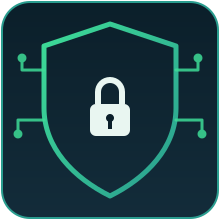
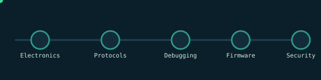

<p align="center">
  
</p>

<h1 align="center">Hardware Security Field Guide</h1>

<p align="center">
  
</p>

**A practical, beginner-friendly guide to understanding, debugging, and securing hardware and IoT devices — from basic electronics and communication protocols to firmware analysis and responsible security testing.**

[](LICENSE)
[](mkdocs.yml)
[](.github/workflows/docs-ci.yml)

---

## 1. What is this?

A structured, step-by-step guide that starts with "what is voltage" and ends with "how do I extract and inspect firmware from a device I own." Every guide follows the same template — what it is, why it matters, how it works, what you need, how to do it, what should happen, what can go wrong, safety limits, and an honest verification status — so you always know what's been actually tested versus reviewed-only.

## 2. Who should use it?

Students, electronics hobbyists, embedded engineers, IoT developers, and anyone starting out in hardware security who wants to build real understanding rather than copy-paste a command they don't understand.

## 3. What can you learn or build?

By the end of the current guides you will be able to: measure and reason about logic-level voltages safely, wire and read a UART console, locate an undocumented UART interface with a logic analyzer, extract and hash a firmware image from a device's SPI flash chip, and build a simple threat model for a piece of hardware.

## 4. How do you get started?

```bash
git clone https://github.com/NirmalyaLenka/hardware-security-field-guide.git
cd hardware-security-field-guide
pip install -r requirements.txt   # only needed if you want to build/preview the docs site
```

Then read [`docs/getting-started.md`](docs/getting-started.md) — it tells you the minimum hardware to buy (around $20–30 total) and walks you through your first hands-on hour.

## 5. Topic overview

| Level | Topic | Status |
|---|---|---|
| 1 | [Electronics Fundamentals](docs/electronics/fundamentals.md) | Available |
| 2 | [UART](docs/protocols/uart.md) | Available |
| 3 | [Finding an Unlabeled UART Console](docs/debugging/uart-console-discovery.md) | Available |
| 4 | [Firmware Basics](docs/firmware/firmware-basics.md) | Available |
| 5 | [Threat Modeling](docs/hardware-security/threat-modeling.md) | Available |
| 6 | [Lab 01: Boot Console](docs/practical-labs/lab-01-uart-console.md) | Available |

See [`docs/learning-path.md`](docs/learning-path.md) for the full planned progression and an honest list of what isn't written yet.

## 6. Beginner's quick-start path

1. [`docs/electronics/fundamentals.md`](docs/electronics/fundamentals.md)
2. [`docs/protocols/uart.md`](docs/protocols/uart.md)
3. [`docs/practical-labs/lab-01-uart-console.md`](docs/practical-labs/lab-01-uart-console.md)
4. [`docs/safety/index.md`](docs/safety/index.md) — read this before anything else below it

## 7. Documentation navigation

| Page | Purpose |
|---|---|
| [`docs/index.md`](docs/index.md) | Landing page for the docs site |
| [`docs/getting-started.md`](docs/getting-started.md) | What to buy, your first hour |
| [`docs/learning-path.md`](docs/learning-path.md) | Full level-by-level progression and status |
| [`docs/safety/index.md`](docs/safety/index.md) | Authorized-use policy and electrical safety |
| [`docs/glossary.md`](docs/glossary.md) | Term definitions |
| [`docs/faq.md`](docs/faq.md) | Common questions |
| [`docs/references.md`](docs/references.md) | Consolidated source list |

## 8. Supported hardware, tools, and environments

- **Boards:** ESP32 and Arduino-family dev boards (used in all current examples).
- **Tools:** any DC multimeter; a Saleae-compatible logic analyzer with `sigrok`/PulseView; a USB-to-UART adapter (CP2102/CH340/FT232-based); a CH341A-style SPI flash programmer with `flashrom`; `binwalk`.
- **OS:** instructions are written for Linux first, with Windows/PuTTY equivalents noted where they differ; macOS is generally identical to Linux for the serial-tool steps shown.
- **Docs site:** MkDocs + Material. Run `pip install -r requirements.txt` and `mkdocs build --strict`; the dated verification report records the exact environment and result.

## 9. A small example

[`examples/protocol-demos/uart_logger.py`](examples/protocol-demos/uart_logger.py) is a working, documented Python script that connects to a serial console and logs it to a timestamped file — the companion tool for the UART guide and Lab 01. Run `python3 -m py_compile examples/protocol-demos/uart_logger.py` to confirm it's syntactically valid without any hardware attached.

## 10. Testing and verification policy

Every guide states its own verification status (hardware-tested / simulator-tested / reviewed-only), with date and environment where testing actually occurred. Project-wide automated checks live in [`tests/`](tests/README.md): internal link checking, regression tests for the checker, a strict MkDocs build, and Python syntax checks for the scripts and examples. **Latest local audit snapshot (2026-11-24): 9/9 link-checker regression tests passed; 21 Markdown files checked with 0 broken internal links; Python compilation and both YAML parses passed; `mkdocs build --strict` passed locally in 3.19 seconds.** Material for MkDocs printed an upstream compatibility warning about future MkDocs 2.0 changes, but the build completed successfully. The GitHub Actions workflow has not yet been confirmed on GitHub-hosted infrastructure. A clean automation result does **not** mean every hardware variant or operating-system instruction has been physically tested. Full scope is in [`tests/verification-report.md`](tests/verification-report.md). See [`tests/verification-report.md`](tests/verification-report.md) for the dated results of the most recent full run, including what was and was not executed.

## 11. Safety and authorized-use policy

All practical content here assumes you are working on hardware you own or are explicitly authorized to test. Read [`docs/safety/index.md`](docs/safety/index.md) in full before attempting any hands-on exercise — it also covers electrical safety and responsible vulnerability disclosure.

## 12. Contributing

See [`CONTRIBUTING.md`](CONTRIBUTING.md) for the required guide template, the honesty requirement around verification status, and the writing-style rules (including: do not copy text or structure from other hardware-security references). Participation is governed by [`CODE_OF_CONDUCT.md`](CODE_OF_CONDUCT.md).

## 13. Documentation and reference credits

This project was independently designed and written; see [`docs/references.md`](docs/references.md) for the datasheets, standards, and tools cited throughout, and for an explicit note on the community project ([swisskyrepo/HardwareAllTheThings](https://github.com/swisskyrepo/HardwareAllTheThings)) whose scope — not whose text or structure — inspired this guide.

## 14. License

[MIT](LICENSE).

## 15. Start learning

Open [`docs/getting-started.md`](docs/getting-started.md), or jump straight to [Lab 01](docs/practical-labs/lab-01-uart-console.md) if you already have a dev board on your desk. Contributions that extend the [learning path](docs/learning-path.md) are welcome.
